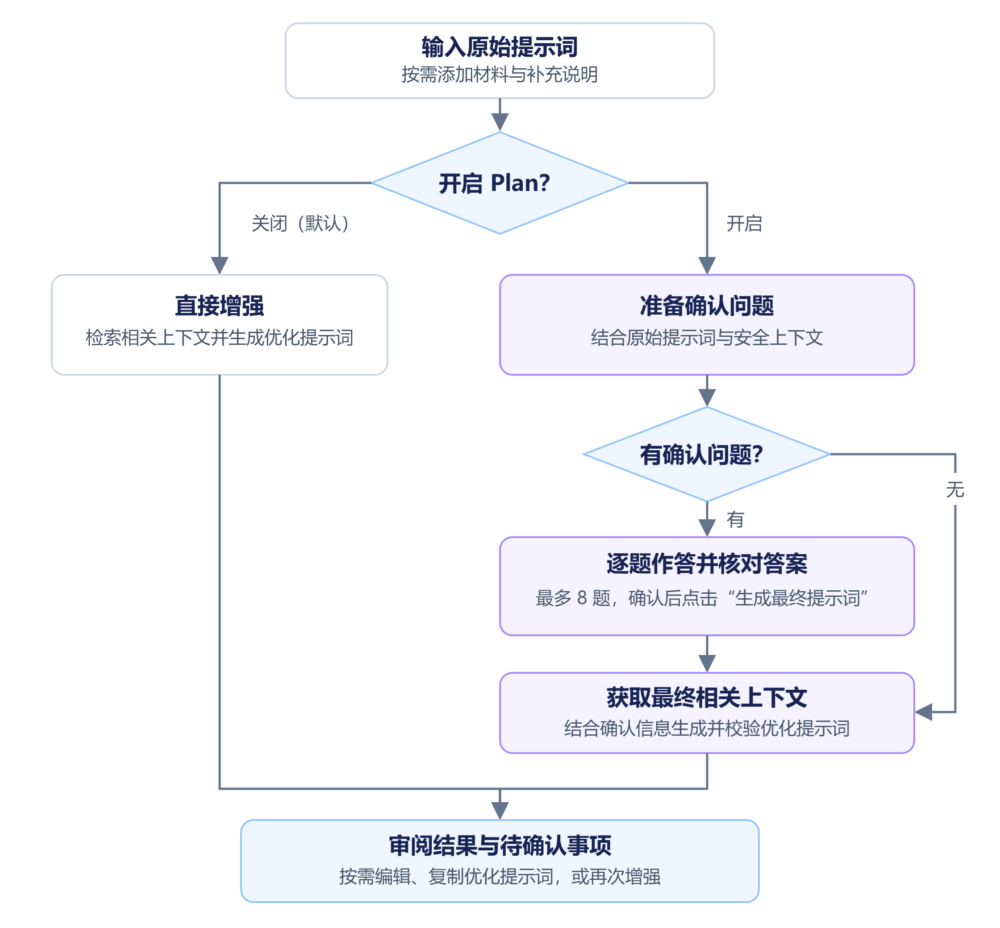

# Prompt Optimizer Platform

面向开发者、学生、视觉与文案创作者、办公人员和科研工作者的 AI 提示词工具平台，提供三项核心功能：**提示词增强**、**素材转提示词**（原图像转提示词）和独立的**文章祛 AI 味**工作台。

**把想法与参考素材整理成清晰的提示词，把已有文章润色成适合读者的表达。** 提示词增强结合用户主动提供的项目上下文，支持自然正文、结构化表达和可选 Plan 确认；素材工作台结合经审阅的图片、代码、文档与配置，支持直接生成、Plan 确认和明确的保留／修改要求；文章工作台直接交付润色正文。

> 当前阶段：MVP 本地联调与内部试用。三项核心功能均已有独立工作台和历史入口，复用平台身份与模型目录。提示词增强、图像理解与 Plan 创作、三档文体润色及正文差异对比已有工程实现；正式上线仍需完成拟开放模型的真实业务验收、双人评审及部署验收。团队管理、额度计费和浏览器插件等仍属后续范围。

## 项目简介

在使用 ChatGPT、DeepSeek、Claude 等大模型进行开发、写作或分析时，一句需求和相关材料未必能直接换来满意结果。影响因素包括需求表达、上下文选择、增强策略和执行模型能力，不能把问题都归因于用户没有说清楚。平台应承担理解与整理的工作，并通过实际输出检验增强是否有帮助。

Prompt Optimizer Platform 围绕三类任务提供对应入口：

| 功能与页面入口 | 主动提交的材料 | 实际交付 |
| --- | --- | --- |
| 提示词增强（`/workbench`） | 原始提示词，以及按需提供的代码、文档或项目背景 | 保留原任务意图的优化提示词，可选择自然正文或结构化表达、按需开启 Plan |
| 素材转提示词（原图像工作台，`/image-to-prompt`） | 正式账号可审阅图片、PPTX、短视频、代码、配置、文档、粘贴内容和文件夹中的可读资料；按任务选择目标与用途 | 供下游执行代码开发、内容处理或视觉创作的优化提示词，附来源与覆盖限制；支持直接生成及 Plan |
| 文章祛 AI 味（`/text-polish`） | 已有正文，以及文体、读者、保留文字等要求 | 可与原文对照、编辑和复制的润色正文 |

提示词增强把需求整理这一步放在执行之前：结合**原始提示词、用户主动提供的项目上下文、本次 Plan 确认答案和平台安全规则**，组织目标、输出要求、约束与待确认信息。你不必先掌握一套复杂的提示词写法，也可以从一句自然语言开始。

常用路径是：**写下想法 → 按需添加材料 → 直接增强或 Plan 确认 → 审阅、编辑并复制优化提示词**。图像工作台另有自己的视觉分析与创作问答，不自动读取文本工作台的文件、源码或 Plan 会话。

提示词增强模块交付优化提示词，并保持你原本想完成的任务：要写报告，就增强“写报告”的要求；要做方案，才围绕方案组织提示词。资料不足不应把任务改成补材料问卷或通用大片填空模板。该流程后续的写文章、分析数据或修改代码，由你选择的模型或工具执行；本平台不会自动执行命令、提交代码、发送邮件或部署系统。

素材转提示词在原图像工作台上扩展，沿用 `/image-to-prompt` 入口。视觉任务关闭 Plan 时还原所选参考图片、页面或视频帧，开启后辅助创作；代码、文档和其他任务按用户目标直接生成，或通过 Plan 确认关键缺口。允许组合经审阅的文字资料与视觉参考，指定技术栈、实现方式、交互、内容与保留条件。普通 JPEG／PNG 的单图快捷提取及访客单图试用继续保留。平台交付优化提示词，实际开发、写作及成品制作由下游执行。见[素材转提示词使用说明](./docs/development/素材转提示词实现与使用说明.md)。

独立的“文章祛 AI 味”工作台接收已有正文，提供**正式清晰、自然流畅、轻松交流**三档文体，支持正文差异对比、编辑复制和私有历史保存。默认自然流畅，切档不调用模型；管理员在统一模型管理中单独设置润色模块的可用模型和默认项。它不接入提示词增强或任何 Plan 流程，也不提供 AI 检测分数或检测通过率承诺。见[文章润色使用说明](./docs/development/文章祛AI味实现与使用说明.md)。

## 适合哪些使用场景

按材料与交付目标选择工作台：原始提示词及项目上下文可在提示词增强中整理；需要审阅多份来源、组合参考与新内容时进入素材工作台；已有文章的表达调整进入独立润色工作台。具体效果仍需结合材料和所选模型核对。

| 用户与场景 | 可以从这样的需求开始 | 使用与核对重点 |
| --- | --- | --- |
| 开发者：功能、排错、重构与测试 | “给现有工单增加升级处理功能” | 现有实现、修改范围、状态与权限规则、异常分支及验证方式 |
| 学生与教师：学习和资料整理 | “根据这些课程资料制定复习计划” | 当前水平、知识范围、可用时间、练习方式和引用来源 |
| 文案创作者：文章、邮件与演讲稿 | “把这份活动资料改成公众号预告” | 目标受众、发布渠道、语气、篇幅及必须保留的事实 |
| 办公与运营人员：纪要、报告和方案 | “把会议记录整理成行动清单” | 议题、已确认决议、负责人、期限和仍待核实的信息 |
| 科研与分析人员：研究方案和分析需求 | “根据数据字典整理统计分析要求” | 研究对象、数据来源、指标口径、方法条件和交付形式 |
| 视觉创作者：参考图还原 | “根据这张参考图，整理供绘图工具使用的提示词” | 关闭图像 Plan，描述实际可见的主体、关系、构图、风格和不确定内容，不承诺像素复刻 |
| 设计与运营人员：Plan 辅助创作 | “为读书会设计一张海报，参考这张图的配色” | 开启图像 Plan，填写构想，按需指定参考图的主体／风格／布局用途，确认后生成新图提示词 |
| 已有文章：表达润色 | “将这篇说明调整为自然流畅，保留原有事实与指定原句” | 在文章工作台选择三档文体之一，核对正文差异，编辑或保存为私有历史；不进行 Plan 问答 |

开发、学习、写作、办公和科研的文字需求共享提示词增强工作台，尚未按职业分别提供专用编辑器；图像与文章润色各有独立工作台。三项功能均未完成所有专业领域的质量验收。输入研究方案不代表已经取得研究结果，上传数据字典也不代表已经提供实际数据；生成内容仍需保留这些区别。

## 核心能力

前六项介绍提示词增强的能力，后两项分别介绍图像工作台和独立文章润色工具。三者复用平台基础设施，业务输入、生成链路和历史分别管理。

### 1. 一键增强提示词

输入原始提示词，按需添加文件或背景说明，点击增强即可开始。工作台默认直接生成结果；开启“Plan 确认”后，先补充会影响结果的决定，再生成优化提示词。

工作台保留原始提示词，结果支持编辑、复制和再次增强。“再次增强”使用当前结果作为新的输入，并遵循当前 Plan 开关；“复制并打开”目标平台后，仍由用户自行粘贴和发送。

### 2. 需求明确化

将“帮我处理一下”进一步组织为“处理哪些材料、要交付什么、哪些规则必须遵守”。系统结合本次需求和可用上下文识别未决信息；开启 Plan 时用自然语言提问，直接增强时则允许在结果中保留待确认事项。

例如，演讲稿任务需要说明受众、场合和时长，研究任务需要核对对象、数据来源和分析口径，软件任务需要明确行为规则和影响范围。没有依据的事实不能变成既定信息；用户委托的方法设计可以给出拟议方案和适用条件，真正影响结果且只有用户能定的选择仍需确认。

### 3. 项目上下文化

把你提供的代码、项目说明、草稿、报告或表格作为本次需求的依据，减少重复描述背景。代码项目可以识别技术栈、依赖和目录结构；普通材料可以提取文本，并围绕当前任务检索相关片段。

- **代码项目**：浏览器对主动选择的目录建立本地索引，生成前检索有限的相关代码块。
- **文档材料**：支持 PDF 文字层及 Word、Excel、PowerPoint 文本提取；JPEG／PNG、扫描或混合 PDF 可在逐页预览、遮挡并明确同意后，通过已接入的视觉大模型识别，无需独立 OCR 服务器。大型文档采用分片上传和临时索引。
- **覆盖情况**：解析失败、截断或覆盖不足会通过分析报告和警告展示；文件被选中不等于全部内容已进入模型。

浏览器只处理用户主动选择的文件，不读取任意本机路径。使用真实模型时，参与本次生成的内容会经后端发送给模型供应商；本地索引不等于全程离线。临时索引和历史保存范围见下方“当前实现边界”。

上下文视觉识别复用模型管理的视觉能力登记，选择页与调用费用单独确认；未识别或失败页会明确提示，成功结果由 Plan 和最终增强复用，不重复识图。识别后脱敏无法阻止原图隐私首次被供应商看到；禁止外发的资料应选择“仅本地提取”。见[图片与 PDF 上下文识别使用说明](./docs/development/图片与PDF上下文识别使用说明.md)。

### 4. 约束条件完善化

依据本次任务补充约束重点：软件任务关注参数、异常、兼容性和测试；研究分析关注数据来源、统计口径、方法条件与不确定性；通用任务关注交付范围、事实依据和明确的格式要求。

原始需求中的条件、否定、数值与已确认答案会参与结果校验和补全。自然模式同次生成核对适用要求、实际缺口和正文覆盖，Plan记录提问影响，但不能保证识别所有领域的语义错误；事实、数字、引用和专业方法仍需用户复核。自然模式不自动追加平台固定条款，结构化链路保留原有条款策略，用户明确追加权限与服务端安全过滤继续保留。

### 5. 结构化输出

**两种模式使用不同生成策略。** 默认直接增强使用独立自然链路，理解原任务并按必要缺口补充内容，框架只作组织诊断；开启“结构化提示词”后，使用原生成器按五类标准模块组织，有独立内容才呈现，不为填满模块生成通用文字。工作台无需手动选择模板。

| 输出内容 | 当前 MVP 行为 |
| --- | --- |
| 背景、任务、输出、约束 | 自然模式直接输出完整正文，不生成四个假段落；结构化模式显式呈现背景、任务、输出要求、约束条件。 |
| 验收标准 | 结构化模式保留明确要求或有独立检查价值的验收，不再用模板默认文字凑第五模块；自然模式仅补任务适用且可检查的要求。具体质量与冗余继续验证。 |
| 示例要求 | 示例参考开关已退役；按原始提示词、实际题答中的举例要求、禁令与格式处理。 |
| 待确认事项 | 有实际未决信息时出现；执行前必须确认的条件也会进入可复制正文。 |

紧凑／分节的显示、复制、编辑及历史元数据已接通。新自然正文支持版本控制保存、失败保稿及同记录编辑撤销；普通默认仍为NATURAL/31，已知部分需求可能因回应分类跳过正文并拼接源码。解耦生成、上下文召回及正文修复候选正在按真实工作台和同信息实际作品验证，尚未证明稳定整体收益或切换日常版本，见[2026-10-28当前验收记录](./docs/testing/自然增强真实工作台与实用交付验收-2026-10-28.md)。旧版本指导冻结兼容，全部来源、实际题答与正文覆盖保护保持。实现及兼容范围见[独立自然增强与 Plan 链路](./docs/development/独立自然增强与Plan链路.md)。

### 6. 权限红线与安全边界

提示词增强对提交的上下文过滤默认受保护路径，并对可识别的敏感内容执行检测或脱敏。自然模式不自动追加固定条款，用户已明确的保密与权限要求仍保留；结构化链路按任务保留凭据保护、受保护文件范围及人工确认等既有条款策略。可复制正文和服务端安全过滤分别处理，不因自然正文取消固定块而关闭输入保护。

上传内容仅作为资料，不能覆盖平台安全规则。API 支持追加受保护路径和确认动作，不能关闭平台默认红线；当前工作台使用默认规则。这里的权限红线用于生成任务边界，实际执行权限仍由下游工具和用户控制。

### 7. 素材转提示词、参考还原与 Plan 确认

原图像工作台增加“代码与页面”“文档与内容”“其他任务”。上传资料后先在平台本地提取可读内容；审阅并勾选片段、指定用途和目标、确认接收模型与隐私后，才进行模型处理。通用任务可直接按明确要求修改，也可开启 Plan 只确认关键未知；目标不是由文件后缀决定。来源快照、实际题答、最终正文及编辑版本进入原历史分类，统计记录直接提交、Plan、生成、再次优化与成功复制；重放操作不重复记业务成功。完整支持范围、接口和限制见[使用说明](./docs/development/素材转提示词实现与使用说明.md)。

以下两条为保留的视觉任务路径：

独立图像工作台提供两条路径：

- **参考内容还原**：关闭 Plan，正式账号可选择图片、PPTX 或短视频；多媒体先解析、审阅并勾选参考范围，再直接生成描述性提示词，不提创作问题或新增主体、场景。普通 JPEG／PNG 保留单图快捷流程，访客继续使用单图试用。
- **Plan 创作**：开启 Plan，先写文字构想，可以不附素材；也可添加参考来源与新主体／新内容，明确保留、替换、移除或融合关系，生成图片、视频或 PPT 的优化提示词。指定画面文案按原文保留；要求充分时可以零问并确认生成。

用户可以选择提示词语言、下游工具，以及创作所需的项目背景摘要；不自动读取本机项目或复用文本增强的上下文。切换 Plan 保留当前 Pinia 草稿中的素材编号、所选页／帧和遮挡，关闭时替换素材仅保留在草稿、不参与还原；切换后需重新确认模型外发。刷新或关闭页面不保证恢复内存草稿。结果支持查看视觉分析、编辑、复制和私有历史；基于已有文字再次优化使用已保存正文与分析摘要，不重新读取原件。

选择文件不会自动上传。普通单图快捷流程在用户检查隐私、勾选同意并主动提取后上传和调用模型；多媒体则先由用户点击上传到本平台进行本地解析与私有预览，这一步不调用模型。审阅、选择范围和遮挡后，还需单独确认外发，模型只接收本次选中的画面及允许的结构文字。每任务最多六份素材、十二个图片／页／帧；图片单张仍为 10 MiB，其他素材单文件最多 50 MiB，视频每段最多 30 秒。服务端继续校验实际格式和像素预算，校正 JPEG 方向并清理元数据；私有临时素材约一小时失效，长期历史不保存原件或 Base64。带图调用必须使用已登记视觉能力的可用模型，Mock 仅为演示。无需独立 OCR 服务，但不保证小字识别、像素复刻或下游成品效果。详细限制见[实现与使用说明](./docs/development/图像转提示词实现与使用说明.md)。

### 8. 文章祛 AI 味：独立正文润色

`/text-polish` 接收已有正文并直接交付润色结果，**不生成供下游使用的润色提示词，不接入提示词增强或图像模块的 Plan**。

| 文体 | 适用表达 |
| --- | --- |
| 正式清晰 | 报告、商务邮件和正式说明 |
| 自然流畅（默认） | 一般文章和日常沟通 |
| 轻松交流 | 社交内容和面向大众的介绍 |

切换文体只更新设置，用户点击润色才调用模型。支持指定原样保留的文字、改写幅度、读者与补充要求；结果可对照原文查看增删差异，编辑保存、复制、基于原文重新生成或以已保存当前稿继续润色。私有历史保留原始输入、生成快照、当前编辑稿、文体及来源修订；查询和修改受用户、租户、工作区范围限制，删除采用逻辑删除。关闭历史持久化的演示模式只在服务内存中保留记录。

模型来自统一平台目录，但文章模块有独立准入列表与默认模型，由管理员在“模型管理 → 文章润色模型”配置；用户只能选择已开放的模型，端点和密钥留在服务端。正文及必要设置会发送给所选模型，不是本地离线润色。当前输入最多 12000 字符；差异提示和保留文字检查辅助人工核对，不承诺语义完全不变或通过 AI 检测。使用方式与模型配置见[实现与使用说明](./docs/development/文章祛AI味实现与使用说明.md)。

## Plan Mode 增强方法

本节描述提示词增强的 Plan；图像创作有独立的 Plan 输入与问答协议，文章润色不使用 Plan。

Plan 默认关闭，首次开启会显示说明，选择保存在当前浏览器中。它适合需要先明确范围、方法或交付要求的任务。



1. **先看材料**：有文件时，先检索相关片段并准备经过安全处理的上下文摘要和证据；没有文件时，也可直接依据原始提示词和补充说明开始。
2. **识别关键问题**：结合已知信息生成最多 8 个确认问题，支持单选、多选和自由输入。已提供的事实用于减少重复追问；没有需要提问的内容时，直接进入最终生成。
3. **主动确认答案**：推荐项不会自动成为你的选择。可以选择候选项，在允许时填写自定义回答，也可以回看并修改已填答案；自定义回答会替换已选项。所有题目填写有效答案后，点击“生成最终提示词”。
4. **按答案再次检索**：使用原始需求和确认答案重新选择相关上下文，服务端核对答案与本次计划、需求及上下文的对应关系，再生成和校验结果。
5. **审阅并使用**：原始提示词保留，最终生成自动保存优化记录；用户检查事实和未决条件后，可以编辑、复制或再次增强。计划提问阶段不生成优化记录，页面编辑也不会覆盖原历史记录。

“暂不确定”仍属于未决信息，二次检索发现的新冲突也可能继续显示在结果中，并写入正文的执行前确认要求；完成问答不代表所有条件都已确定。计划过期时会重新生成问题，并提示核对可恢复的答案草稿后再次确认。

关闭 Plan 时，按原始需求检索一次最终上下文，直接调用生成接口；服务端仍执行上下文分析、安全过滤、结构校验和模糊点检测。详细契约见[内置 Plan Mode](./docs/12-内置Plan-Mode交互与接口.md)。

## 使用示例

以下为人工编写的结构化示意，展示增强时应明确的内容；实际输出会随材料、确认答案、模式和模型变化。自然模式输出自然正文，不自动追加固定条款。

### 开发场景：从一句需求到可核对的任务说明

原始提示词：

```text
用 requests 库爬取某个网页的标题。
```

优化提示词示意：

```text
背景：使用 Python requests 获取用户指定网页的标题，目标 URL 由用户提供。

任务：编写网页标题提取函数，说明调用方式及所需依赖。

输出：提供代码、调用示例和错误处理说明，成功时返回标题字符串。

约束：
1. 处理空 URL、非法 URL 和网络异常。
2. 设置合理的请求超时时间。
3. 处理网页编码异常和不存在 title 标签的情况。
4. 输出清晰的错误提示，不打印敏感请求头或凭证。
5. 遵循 PEP 8，并补充正常、异常和边界测试。

验收标准：覆盖正常网页、缺少标题、非法 URL 和网络异常，不泄露凭据。
```

### 写作场景：把素材、受众和表达要求放在一起

原始提示词：

```text
根据上传的活动资料，写一篇面向初学者的公众号预告，300 字左右，语气亲切。
```

优化提示词示意：

```text
背景：依据用户上传的活动资料，为初学者准备公众号活动预告。

任务：提炼活动主题、适合人群和参与方式，保持亲切、容易理解的表达。

输出：约 300 字的预告正文，清楚说明读者可以了解什么、如何参与。

约束：仅使用资料中能够核实的事实；不编造讲师经历、效果承诺、时间或费用。
如果报名方式等执行所需信息缺失，将其列为发布前须确认的条件。

验收标准：受众、篇幅和语气符合要求；关键事实可回到材料中核对。
```

这两种提示词增强场景得到的都是交给下游模型的任务说明，本平台不在此执行代码或直接交付文章。已有正文需要润色时，请使用独立文章工作台，它交付的是润色正文。

## 使用建议

- 先写目标，再补充用途、受众和期望交付形式；复杂需求拆成可以独立描述的任务。
- 对会改变结果的重要决定使用 Plan；已有明确要求时可以直接增强。
- 图像还原与新图创作按目标选择模式；附图前检查隐私，生成后将提示词复制给自己的绘图工具。
- 已有文章选择独立润色工具，先确定文体和需要保留的文字，再通过正文差异核对事实与语义。
- 按需上传相关材料或提供输出示例，发送前检查内容范围并移除凭据及不必要的个人信息。
- 生成后核对事实、数字、引用和待确认事项，再复制给下游模型；重要约束应保留在正文中。
- 研究、学习和专业材料保留来源与人工复核要求，不用生成内容冒充已完成的实验、真实数据或权威结论。

## 项目定位与边界

平台当前提供三个工作台：上下文感知的提示词增强、由图像工作台扩展的素材转提示词、已有文章的独立润色。前两项交付提示词，文章工具交付润色正文；素材 Plan 与文本 Plan 分别管理，文章不加入任一 Plan。资料解析提供有覆盖范围的证据，不能由静态源码证明真实运行效果或完整调用关系。项目上下文处理、私有历史和基础认证已有实现；自动执行代码、浏览器或桌面操作、自动发送消息、产品内绘图及生产部署不属于当前产品能力。

后续方向包括更细的领域策略、按需展示与分段复制、更多视觉／润色模型与场景的质量验证、浏览器/IDE 插件，以及团队协作和额度计费，具体以[待办事项](./docs/待办事项.md)为准。文本上下文已经提供 JPEG／PNG 和扫描 PDF 的独立视觉审阅链；普通文件文字层提取不会自动识图。素材工作台的源码关系分析、动态网页、音频和专有工程格式仍需独立扩展与验收。

医疗、法律、财务等高风险领域的专用能力仍需独立设计与评测；平台不承诺优化提示词或下游模型结果具备专业结论效力。跨行业效果、节省 Token 或减少返工的幅度，需要真实使用证据，不能从结构校验或 Mock 测试推导。

## 1. 项目目标

- 将开发、研究、学习、写作和分析等需求整理为保留原意的优化提示词，支持自然正文与结构化表达。
- 从参考图片提取描述性提示词，或通过文字构想与可选参考图辅助规划新图提示词。
- 为已有文章提供独立润色工作台，支持三档文体、正文差异核对与私有历史。
- 在不默认持久化项目源码的前提下，分析技术栈、目录结构、依赖和用户提供的代码片段。
- 通过统一 Provider 接口接入 Mock 与 OpenAI 兼容模型服务，并为更多供应商适配预留空间。
- 在个人账户、优化历史和基础审计之上，逐步扩展团队协作、额度计费和插件能力。

## 2. 推荐技术栈

| 层次 | 技术 | 选择理由 |
| --- | --- | --- |
| Web 前端 | Vue 3 + Vite + TypeScript + Element Plus | 开发效率高、组件生态成熟、适合后台型 SaaS |
| 前端状态 | Pinia + Vue Router + Axios | 状态边界清晰，便于后续接入权限和多工作区 |
| 后端 | Java 21 + Spring Boot 3 + Spring MVC | 长期维护、企业生态成熟，适合模块化单体起步 |
| 安全 | Spring Security + JWT（可选） | 便于从匿名试用过渡到登录、团队和 API Token |
| 数据库 | PostgreSQL 16 | 事务、JSONB、全文检索和扩展能力适合提示词与用量数据 |
| 缓存 | Redis 7 | 限流、短时上下文缓存、会话和异步任务状态 |
| API 文档 | OpenAPI 3 | 前后端契约共享，也方便未来 IDE 插件调用 |
| 构建与部署 | Maven、Docker、Docker Compose、Nginx | 本地启动简单，生产环境可迁移至 Kubernetes 或云托管 |
| 可观测性 | Micrometer + OpenTelemetry（规划） | 监控接口耗时、模型耗时、Token 用量和错误率 |

### 为什么选择 PostgreSQL

本项目既有稳定的关系数据（用户、工作区、历史、配置、用量），又有结构会演进的 JSON 数据（上下文摘要、优化结果元数据、Provider 扩展字段）。PostgreSQL 可以用关系表保证一致性，用 JSONB 承载可演进字段，同时避免第一阶段引入文档数据库的运维复杂度。

## 3. 文档导航

- [文档总览](./docs/README.md)
- [产品与范围](./docs/01-产品与范围.md)
- [系统架构](./docs/02-系统架构.md)
- [模块设计](./docs/03-模块设计.md)
- [数据模型与 ER 图](./docs/04-数据模型与ER图.md)
- [API 接口契约](./docs/05-API接口契约.md)
- [上下文分析设计](./docs/06-上下文分析设计.md)
- [大模型供应商设计](./docs/07-大模型供应商设计.md)
- [安全、隐私与商业化基础](./docs/08-安全隐私与商业化基础.md)
- [部署与运维](./docs/09-部署与运维.md)
- [迭代路线图](./docs/10-迭代路线图.md)
- [提示词增强能力设计](./docs/11-提示词增强能力设计.md)
- [内置 Plan Mode 交互与接口](./docs/12-内置Plan-Mode交互与接口.md)
- [独立自然增强与 Plan 链路](./docs/development/独立自然增强与Plan链路.md)
- [素材转提示词：实现与使用说明](./docs/development/素材转提示词实现与使用说明.md)
- [保留的图像与多媒体路径：实现与使用说明](./docs/development/图像转提示词实现与使用说明.md)
- [图像转提示词：本机验证与质量边界](./docs/testing/图像转提示词本机验证-2026-10-25.md)
- [文章祛 AI 味：实现与使用说明](./docs/development/文章祛AI味实现与使用说明.md)
- [文章祛 AI 味：实现与真实评测](./docs/testing/文章祛AI味实现与真实评测-2026-10-25.md)
- [上下文感知 Plan Mode 实现教学](./docs/development/上下文感知Plan-Mode实现教学.md)
- [提示词优化与通用场景调研](./docs/research/Qoder提示词优化与大众场景调研.md)
- [待办事项](./docs/待办事项.md)
- [领域语言](./CONTEXT.md)
- [架构决策记录](./docs/adr/)

<a id="enhancement-plan-direction"></a>
### 开发协作

修改提示词增强与 Plan 前，请阅读[项目协作约束](./AGENTS.md)和[开发原则、实施依赖与验收方案](./docs/14-提示词增强与Plan最小干预优化方案.md#enhancement-development-direction)。当前进度、未完成项与验证证据见[待办事项](./docs/待办事项.md#current-enhancement-status)。

## 4. 目录约定

```text
prompt-optimizer-platform/
├─ apps/web/                 # Vue 3 前端工程（三项功能工作台与管理页面）
├─ services/api/             # Spring Boot 后端工程（核心 MVP）
├─ packages/contracts/       # 前后端共享的 OpenAPI/JSON Schema 契约
├─ docs/                     # 产品、架构、数据、API 和运维文档
├─ infra/                    # Docker、反向代理和部署配置
├─ scripts/                  # 开发、校验、迁移辅助脚本
├─ CONTEXT.md                # 项目领域语言和命名约定
└─ README.md
```

## 5. 当前实现边界

2026-10-31补充：[有效补全依据修复与作品验收](./docs/testing/自然增强有效补全依据修复与作品验收-2026-10-31.md)新增显式试用配置 `COMPLETION_BASIS_REPAIR`（`core-repair-v3`）。135项定向Java检查通过；真实阅读等待、明确复述和报告回归通过，实际代码作品与原始/31相同且均通过10项检查，只计持平。阶段13次调用、同任务累计30/32；整体质量收益及默认采用仍未证明，默认31、运行服务未变。

2026-10-31 [文档上传并发与跨浏览器稳定性修复](./docs/testing/文档上传并发与跨浏览器稳定性验收-2026-10-31.md)：每文档最多 3 片、普通文档最多 2 份流水处理；完成确认幂等，暂时网络错误有限重试，后台标签页先核对服务端状态；过期清理移出进度请求，容量预留原子化。49 项后端、42 项前端、12 次浏览器配置检查及真实办公文档流程通过。Chrome/Edge 同输入受控延迟下上传阶段约减少 56%–58%，本机低延迟总耗时仅小幅改善。索引范围未减少；跨浏览器同账号可按 ID 读取后端临时索引，不等于页面自动恢复或共享浏览器本地源码缓存，不承诺任意环境同速或永不超时。

2026-10-31 最新[新目录被共享旧索引阻塞修复](./docs/testing/文件索引与复杂文档修复流程-2026-10-31.md#edge-index-isolation)：新项目按存储桶隔离，不再先等待无关旧库的升级和清理；不支持桶时保留独立数据库兼容路径，旧 ID 仍可读取。原 Edge 默认存储阻塞时，新路径合成数据写入及末尾检索约 140 毫秒完成；用户“智能流调”实际目录在独立持久 Edge 配置中两次完整处理 8,297 文件，用时约 117／233 秒，失败 0，30 份正文与尾部哈希一致。110 项不同单测、7 项 Edge 检查及构建通过。没有删除用户旧索引或削减文件/正文范围；原挂起页面须刷新重选，旧库原地迁移耗时和更大规模跨设备压力仍未验收，不能承诺固定导入速度。

2026-10-31 后续[文件索引与复杂文档修复流程](./docs/testing/文件索引与复杂文档修复流程-2026-10-31.md)：空存储异常、检查点与失败后继续链路、根文件漏召回已修复，84 项单测和 8 项浏览器回归通过。复杂文档补齐表格坐标、公式缓存、Word 修订过滤、PPT 页序/分组/备注及部分解析提示，53 项后端检查、7 份真实上传和 3 个异常反例通过。后续 Edge“统计 0 文件”反馈已分离旧库准备与实际扫描，补迁移计数、等待耗时和准备中取消，88 项单测、6 项 Edge 回归及实际目录启动检查通过。进一步存储候选未证明整库速度收益，已撤回，生产保留第四版；大型旧库耗时、跨设备压力与全部复杂版式兼容性未关闭，不宣布全部文件处理能力完成。

2026-10-31：[大目录索引容量放大修复与复验](./docs/testing/大目录索引容量放大修复与复验-2026-10-31.md)已将本地全文词索引改用短数字键，完整保留源码、词表和检索契约。真实目录 21,536 个文件处理完成、读取失败 0，23 份正文抽样一致；72 项相关单测、浏览器回归、类型检查和构建通过。整库高层选取的脚本断言有误，原失败记录保留，三个真实文件定向补验通过；不宣称整库选取已验收。导入约 37 分 31 秒，速度、容量耗尽恢复及跨设备压力验收仍待完善，未将本轮局部修复视为文件上传全部完成。

2026-10-30：[工程修复独立配置与简洁基线对照](./docs/testing/自然增强工程修复独立采用与简洁基线对照-2026-10-30.md)已实现：自然增强可用服务端`NATURAL_ENHANCEMENT_PROFILE=CORE_REPAIR`独立试用门控/资料边界和准确来源修复反馈，`STABLE`保留31及回退，历史按原版本。131项定向Java检查通过；使用原48次剩余4次完成两道已见合成题的简洁改写与作品，通知在内部检查范围内可用、CSV通过原16项检查，当前累计48/48次。六份匿名作品中，用户对通知题首选C，解盲对应原始提示词直接执行；本题未显示增强的用户偏好收益，完整人评未完成。没有证明整体质量提升，缺省仍31，日常服务未更新。简洁方案是独立实验，未接入产品或删除来源/权限保护。

2026-10-30补充：[动作与反馈边界修复](./docs/testing/自然增强动作与反馈边界修复-2026-10-30.md)新增独立试用配置 `ACTION_BOUNDARY_REPAIR`（`core-repair-v2`），调整任务动作、完成条件与反馈职责的指导，沿用原来源与正文覆盖保护。148项定向Java检查通过。[2026-10-31真实回归](./docs/testing/自然增强动作边界真实回归与采用结论-2026-10-31.md)使用17/32次新授权调用，阅读等待仍被新增理解说明，候选未采用；未开启未见题或作品阶段，不宣称整体质量提升。默认31、已有CORE_REPAIR=v1与运行服务均未切换。

以下为上一轮44次时点的历史快照，最新调用结算以上方48/48为准。

2026-10-29自然增强状态：旧500次评测保持闭批；新增授权48次实际使用44次。[70真实作品与工作台验收](./docs/testing/自然增强候选70实际作品与工作台验收-2026-10-29.md)验证了79文件完整索引、真实正文生成及复制/历史一致；两道新题的4份候选作品在本次检查范围内可直接使用，但旧培训回归仍有分组和物料衔接待修，完整四臂对照与整体稳定增益未证实。**70未采用，源码默认仍NATURAL/31，日常服务未更新**，已知旧缺陷尚未替换；未生产部署。实现原理见[70输入分层](./docs/testing/自然增强正文输入分层候选70离线实现-2026-10-29.md)，原500次记录见[69闭批结论](./docs/testing/自然增强候选69共同机制修复与作品验收结论-2026-10-29.md)。

三项功能均有工程实现，素材工作台由原图像工作台扩展，边界更新至 2026-10-29。以下区分功能行为、数据与模型边界，以及限定验证范围；工程完成不代表全部模型效果或正式发布验收通过。

- **提示词增强**：`/workbench` 处理原始提示词与主动提供的项目上下文，支持自然／结构化表达及可选 Plan；交付优化提示词，不执行用户任务。JPEG／PNG 与 PDF 可经独立预览和外发确认调用视觉模型提取资料，识别指导与图像创作工作台分别维护。
- **素材转提示词新增资料任务**：同一入口支持代码、文档、配置、粘贴和文件夹中的主动选取范围，可与视觉素材组合。资料本地提取与模型外发分开，通用任务允许明确修改目标的直接生成及可选 Plan；来源快照、题答、编辑正文保留在原历史分类，关键操作进入统计。未提供任意 URL 抓取、完整 AST 调用图或项目执行。具体预算与限制见[使用说明](./docs/development/素材转提示词实现与使用说明.md)。

- **保留的视觉任务**：`/image-to-prompt` 正式账号在两种模式均可使用 JPEG／PNG、PPTX、MP4／MOV／WebM。关闭 Plan 仅描述所选参考来源，不进入问答；开启时需创作构想，可附参考／替换素材。每任务最多六份素材、十二个图片／页／帧；图片仍受单张 10 MiB、1500 万像素、单边 8192 像素限制，视频抽帧需 FFmpeg／ffprobe。单图快捷入口和访客单图试用保留。选择文件不自动上传，多媒体本地解析上传与模型外发同意分开；所选范围和遮挡在模式切换时保留，刷新不保证恢复。临时素材约一小时失效，长期历史只保存文字、题答和来源元数据；这些文字仍可能含敏感内容。没有自动人脸／证件打码或完整隐私识别保证。模型与文本增强共用目录，视觉准入和分批上限继续校验；不生成下游成品。
- **文章祛 AI 味**：`/text-polish` 直接润色已有正文，支持三档文体、正文差异、编辑复制及私有历史，不接入提示词增强或图像 Plan。输入最多 12000 字符，未实现长文分块或个人风格学习；普通模式在 PostgreSQL 保存原始输入与润色版本，关闭持久化的演示模式记录随服务重启丢失。统一模型目录下另有模块准入与默认项，全局停用／删除和路由可用性优先；不额外部署本地 GPU，不提供 AI 检测分数、检测通过率或“真人度”保证。

2026-10-25 文章润色的工程实现、真实样本的保真问题及修正、费用和延迟边界见[使用说明](./docs/development/文章祛AI味实现与使用说明.md)与[验证报告](./docs/testing/文章祛AI味实现与真实评测-2026-10-25.md)。尚未正式部署，不把限定样本当作专业文本或全部模型质量通过。

2026-10-26 图像工作台在 v7 开放非 Plan 多媒体直接还原：正式账号可在关闭 Plan 时上传并审阅 PPTX／视频，所选参考内容经分批 `ANALYZE → GENERATE` 直接形成描述性提示词，不建立问答。模式切换保留临时素材和选区，替换草稿在关闭时不传；V44 仅补充数据库注释，本次未执行。v7 尚未进行真实模型评测，不沿用此前结果宣称其语义质量或正式发布通过。

2026-10-26 此前 v6 已扩展 Plan 多模态创作：参考素材与替换素材分轨，支持 JPEG/PNG、PPTX 选页和受支持短视频抽帧，明确保留／替换／移除／融合关系，生成图片、视频或 PPT 的优化提示词及素材对照说明。支持私有审阅、像素遮挡和独立模型外发确认；Plan 问题置顶、一次定位、移动端待办提示及自主补充卡已接入。视频解析需部署 FFmpeg/ffprobe，模块继续只交付提示词。配置见[实现与使用说明](./docs/development/图像转提示词实现与使用说明.md)；[42/100 次真实评测](./docs/testing/图像多模态素材与结构化替换真实评测-2026-10-26.md)已闭批，限定核心流程通过，比例／坐标判断和低价值问题仍有误差，未完成下游成品或正式发布验收。

2026-10-25 图像转提示词已接入独立工作台：关闭 Plan 还原参考图，开启 Plan 辅助创作新图、参考图可选；支持安全上传、直接调用视觉大模型、问答确认、结果编辑/复制及私有历史，不需要单独 OCR 服务。见[实现与使用说明](./docs/development/图像转提示词实现与使用说明.md)和[本机验证](./docs/testing/图像转提示词本机验证-2026-10-25.md)。真实评测累计 15/20 次（12 次文字/视觉、3 次下游绘图），主链已通；前期运行版本归属错误已更正并复验。当前模型仍会追问已委托设计的内容，成图严格扁平风格有偏差，完整质量及正式发布未通过，不替代原文本增强的采用结论。

2026-10-23当前：[执行资料边界与实际作品对照](./docs/testing/自然增强执行资料边界修复与作品对照-2026-10-23.md)。默认与日常运行继续NATURAL/31；34区分优化时未见资料与执行现场，未新增场景模板或固定约束。96次真实调用含54份作品、四题内部未见回归及Plan；有局部保真和提问收益，未证明稳定作品质量提升，未采用或部署34。前一32/33的60次失败结论保留；本续接100次上限实际96、释放4，累计1789。详细原件、评审纠错及验证边界见报告。

2026-10-23此前：[信息状态共同机制与未见作品验收](./docs/testing/自然增强信息状态共同机制与未见作品验收-2026-10-22.md)。完成25/26来源保真候选、314项受影响Java及打包、109/160次真实调用与68份作品。26在开发题有局部改善，但六道冻结内部未见题出现新的时间/条件错误，Plan确认后未交付；采用未通过，默认保持NATURAL/4，稳定质量提升目标仍未达成。34份历史一致，原件和匿名评审保留；未部署、未应用V31/V32或重启日常服务。

2026-10-22此前：[阶段协议解耦与分层验收](./docs/testing/自然增强阶段协议解耦与分层验收-2026-10-22.md)。完成增强／Plan阶段协议、非权威诊断误拒修复、框架独立对照与内部留出评估，区分工程完成、候选采用和发布。289项受影响Java及打包通过；新增82/96次真实调用，33份历史一致、35份完整作品、25项HTML行为检查完成。24协议修复有效，但信息状态、Plan低价值追问及作品格式仍有不足，未证明整体优于第四版，默认保持NATURAL/4。两批已关闭，未部署、未应用V29／V30或重启日常服务。

2026-10-22两项收敛验证：[补全指导与信息保真验收](./docs/testing/自然增强补全指导与信息保真收敛验收-2026-10-22.md)。15独立补全准备及16—19保真审阅候选均未采用；20撤回额外审阅、仅在第四版单次生成内替换自检。205项受影响Java及打包通过，本轮后续194次真实调用已闭批；20主六题提示词收益最多2/6、作品收益1/6，均未达原3/6标准，且输入缺口仍被提升为实际状态并在作品传播，默认保持NATURAL/4。20的27份成功增强历史一致、34份作品返回；另1份第四版Plan确认后增强最终协议失败、1份作品传输超时，不算候选质量胜出。没有切换默认、应用迁移、重启日常服务或部署候选。第1/2项质量采用目标未达成，不自动开工其他建议。

2026-10-22历史节点：[第四版补全指导收敛与定向复验](./docs/testing/自然增强第四版补全指导收敛与定向复验-2026-10-22.md)。仅实现本条选定的补全指导收敛，NATURAL/13整体压缩、14局部替换共84次真实调用。局部操作收益未达到冻结采用标准，默认仍NATURAL/4；候选仅保留合成历史重放。最终123项受影响Java、32份历史一致性及48份作品检查完成，失败与编辑负担保留，未修改Plan策略或校验协议，未重启日常服务。

2026-10-22此前：[实质补全指导与内部示范对照](./docs/testing/自然增强实质补全与内部示范对照验收-2026-10-22.md)。完成受控候选及208次真实调用，存在局部收益和教学概念错误，尚未证明稳定明显增益，默认保持NATURAL/4。候选7—12仅兼容评测历史重放；未恢复示例开关、自然固定条款或新增逐场景分支。最终120项受影响Java、67份API／历史一致性及56项生成页面操作检查通过，不代表产品整体或发布验收通过。

2026-10-22：[示例参考功能删除](./docs/testing/示例参考功能删除验证-2026-10-22.md)。工作台开关及其前后端生成、组装、模板指导和历史选项已移除；旧请求字段忽略，历史正文保留。原始提示词及真实题答中明确的示例要求继续按用户任务处理。

当前改造：[自然增强要求覆盖与实际作品复验](./docs/testing/自然增强要求覆盖与实际作品复验-2026-10-20.md)。NATURAL/4完成适用要求覆盖、实际缺口补全、Plan提问影响及生成后同次检查，延续目标作品优先和自然模式无自动固定条款。137项受影响Java、33项前端及6项检查工具验证通过；43/48次真实评测闭批，三类充分需求作品并列可用，报告按冻结篇幅检查未过，新版成本增加，跨任务收益待证实。未应用迁移、修改前端产品源码或重启日常服务，正式发布仍按开放范围验收。

前一更正：[自然模式取消固定约束修正验证](./docs/testing/自然模式取消固定约束修正验证-2026-10-20.md)。未开启结构化提示词时不自动添加固定条款，直接及Plan共用；编辑不补回旧固定条款，用户明确权限与服务端安全检查保留。84项后端、33项前端及类型检查通过，真实评测调用0，日常服务未重启；此前固定五条要求已被用户更正。

2026-10-19历史反馈修订：[自然增强目标作品优先与通用策略复验](./docs/testing/自然增强目标作品优先与通用策略复验-2026-10-19.md)。NATURAL/3按目标作品、已有信息和交付约束补充内容，普通执行设计由执行者完成；没有新增按职业、题目或场景命中的生成分支。NATURAL/1、2冻结兼容。223项受影响Java及16/16次真实对照完成；内容与Plan有局部收益，源码作品保留编译失败，未判跨任务稳定胜出。此前节点按其版本和范围理解。

历史节点 2026-10-19 的[通用自然增强与Plan改造及真实评测](./docs/testing/通用自然增强与Plan改造及真实评测-2026-10-19.md)：本会话按确认设计实现自然第二版、任务来源、Plan未知信息推荐保护和旧版本分发，受影响功能已有验证。新增58/60次真实调用已闭批，样例中有额外说明，跨任务增益待证实；评测已修正正文计数和全局状态混淆。此前[独立链路开发验证](./docs/testing/独立自然增强与Plan链路开发验证-2026-10-19.md)与下方2026-10-12基线按各自历史范围理解，逐项证据见[待办](./docs/待办事项.md)。

- **增强与 Plan**：V2自然模式共用新的来源目录与任务理解协议，旧链保留原任务视图及确认融合；可选问答、格式校验和有限修复已有实现。示例参考开关已退役。重要问题筛选、冲突完整性、专业建议、充分需求少改和下游质量仍有缺口；按主方案推进，整体门禁未通过。
- **呈现与编辑**：紧凑／分节正文、复制、编辑、失败保稿、历史恢复、资料发送范围及迟到响应保护已有实现。新自然正文保存与同记录编辑撤销已持久化；旧分节编辑仍只更新当前结果。“再次增强”目前仍用当前结果作为新输入；独立原始基准、版本比较和完整跨标签页流程待完成。
- **历史验证范围（2026-10-19）**：[本轮限定验证](./docs/testing/通用自然增强与Plan改造及真实评测-2026-10-19.md)记录350项受影响Java、13项前端和58次真实调用；评测更正另有4项离线回归。方案机制已实现，样例问题与质量增益待验证分别记录。此前[2026-10-12质量基线](./docs/testing/提示词增强质量修复与真实盲评-2026-10-12.md)的1811通过／6跳过、前端155项、有限浏览器及并发验证只代表当时版本；全仓库、完整浏览器、安全容量和部署仍须按发布范围验收。
- **模型接入**：默认 Mock 无需密钥，服务端可配置 OpenAI 兼容 Chat Completions 路由。供应商、端点与 API Key 由平台管理；用户只选择管理员开放的模型。兼容协议不等于质量相同，原生协议和新增模型须另行适配与验收。
- **文本工作台的上下文**：只处理用户主动选择的文件／目录，不读取任意本机路径；默认发送代码片段前说明范围与目标并确认。代码／文本、Excel、Word、PowerPoint 及 PDF 文字层已有提取；JPEG／PNG 与扫描／混合 PDF 可经逐页预览、遮挡和明确外发同意后识别，未识别页保留警告。其他图片格式仍只提供元数据。详见[上下文设计](./docs/06-上下文分析设计.md)与[识别使用说明](./docs/development/图片与PDF上下文识别使用说明.md)。
- **保留与隔离**：大文件单份最多 50 MiB，原件处理结束后清理；视觉审阅期间保留私有原件供预览，取消或过期清理，临时索引为 2 小时滑动有效期；尚无跨刷新续传／多实例共享文档索引。临时文档读写、预览和检索已核对用户、租户、工作区。本地默认 `SESSION` 仍会把选中合格文件的分块与元数据写入 IndexedDB，默认清理参数 7 天，和“默认不持久化源码”的设计意图存在差异，须按 ME-05 修正并核验；页面清空不代表全部擦除。Plan 会话更细的工作区／任务服务端绑定仍待完善。
- **历史与身份**：Session Cookie、CSRF 和服务端身份已有实现。文本增强历史保存原始／优化提示词及脱敏裁剪的上下文摘要；图像历史保存提示词、视觉分析和来源元数据；文章历史保存原始正文、生成及编辑版本。三类记录独立查询，图像与文章的业务读写按用户、租户和工作区隔离并排除逻辑删除项；不默认保存完整上传文件或密钥，但正文与分析可能含资料衍生信息。不承诺通用对话历史或跨会话个人记忆。
- **商业化及部署**：邮箱注册登录、平台模型管理、管理员统计／审计已有实现；完整账户／团队管理、模型逐次用量日志、额度计费、充值和浏览器插件仍待完善或建设。保持模块化单体，不为本轮增强质量任务拆微服务。
- **专业与上线验收**：按用户决定，上线前自动化、真实模型与跨行业作品检查由 Codex 执行，上线后再组织领域人员核验；AI 盲评不冒充专家结论。未经核验的专业能力不宣称通过，安排见[专业场景排期](./docs/待办事项.md#professional-review-after-launch)。正式发布还须 G1—G8、拟开放模型和实际部署拓扑验收及用户发布授权。

历史关键证据：[P0 资料隔离与失败保稿](./docs/testing/P0资料隔离与失败保稿修复-2026-10-11.md)、[P1 共享任务视图与示例](./docs/testing/P1共享任务视图Plan融合与示例契约-2026-10-11.md)、[分节点保真修复](./docs/testing/衍生指标与完整交付分节点修复验收-2026-10-07.md)、[当前质量修复与盲评](./docs/testing/提示词增强质量修复与真实盲评-2026-10-12.md)。历史版本、失败及调用成本不删除；源码、方案和测试状态以各自范围理解。

后端启动与平台模型路由配置见 [services/api/README.md](./services/api/README.md)。

## 6. 版权与许可

Copyright © 2026 QingNiao0x

本项目按 [PolyForm Noncommercial License 1.0.0](./LICENSE) 发布：允许个人学习、研究和非商业使用；未经作者书面许可，禁止商业使用。

本轮提示词增强／Plan修复进度：见[专业边界与提醒交付闭环验收](docs/testing/专业边界与提醒交付闭环验收-2026-10-08.md)。已补修专业参数独立状态、完整说明与短提醒、已委托呈现追问、选项推荐范围及完整平台句的标点重复；各节点相关测试通过，最终多轮作品与全仓库门禁尚未完成。
