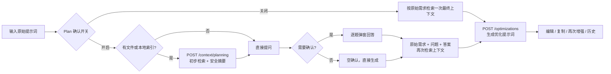

# Prompt Optimizer Platform 项目理解底稿

| 项目 | 内容 |
| --- | --- |
| 文档用途 | 为后续宣传推广、对外讲解、文案与 PPT 制作、用户问答提供统一事实底稿 |
| 文档性质 | 项目理解与素材整理，**不含宣传文案、PPT 成品或对外发布内容** |
| 版本 | v1.0（2026-11-22） |
| 编写角色 | 产品经理（司南） |
| 事实基准 | 仓库文档 + 关键源码路径，逐项标注来源；状态分「已实现」「设计中/待实现」「资料未说明」 |
| 本次优先受众 | **待确认**（未确认前按产品文档列出的首发用户群做分群说明，见 1.3） |

---

## 0. 阅读范围与证据规则

### 0.1 本次已核实

| 类型 | 已核实内容 |
| --- | --- |
| 产品与范围 | `docs/01-产品与范围.md`、`docs/10-迭代路线图.md`、`README.md`（项目简介、核心能力、当前实现边界、项目定位与边界） |
| 增强与 Plan | `docs/11-提示词增强能力设计.md`、`docs/12-内置Plan-Mode交互与接口.md`（第 1—3 节、第 7 节）、`docs/14-提示词增强与Plan最小干预优化方案.md`（第 1、2、6 节） |
| 上下文与模型 | `docs/06-上下文分析设计.md`、`docs/07-大模型供应商设计.md` |
| 安全与架构 | `docs/02-系统架构.md`、`docs/08-安全隐私与商业化基础.md`、`docs/05-API接口契约.md`（接口总览部分） |
| 评测证据 | `docs/testing/自然增强分层验收与独立对照规范.md`、`docs/testing/原始与优化提示词实际执行对照-2026-10-04.md`、`docs/testing/Prompt优化三方业务评测-2026-10-02.md`、`docs/testing/提示词实际交付质量闭环评测.md`、`docs/research/四款提示词增强工具代码级对比-2026-10-23.md` |
| 关键源码路径 | `services/api/src/main/java/com/promptoptimizer/`（enhancement、context、provider、history、identity、imageprompt、textpolish、analytics、policy、payment）、`services/api/pom.xml`、`services/api/src/main/resources/db/migration`（V1—V50）、`apps/web/src/router/index.ts`、`apps/web/src/pages/` |

### 0.2 对前提的一处更正（必须记录）

用户提供的背景摘要称「`README.md` 与 `12-内置Plan-Mode交互与接口.md` 解析失败，本次无法核实其内容」。**本轮已在工作区直接读取这两份文件**（`README.md` 全文分段读取；`docs/12` 读取第 1—3 节与第 7 节结构）。因此本文不再把它们整体标为「未核实」，改为按实际读取范围引用，读取边界见 6.3。

### 0.3 证据分级（全文统一使用）

| 标记 | 含义 | 使用要求 |
| --- | --- | --- |
| 已实现 | 代码路径存在、README 或实现说明有明确行为描述，且有对应验证记录（可能仅覆盖限定范围） | 可对外描述为「已有」，但须同时说明验证边界 |
| 设计中/待实现 | 文档列为目标、后续版本或默认关闭 | 只能作为路线图表述，不得写成现有功能 |
| 资料未说明 | 资料中没有可引用事实 | 不得推断，不得用行业惯例填补 |

### 0.4 口径声明

本文所有「已实现」均指**工程实现**，不等于「已通过正式发布验收」。产品当前阶段为 **MVP 本地联调与内部试用**，正式上线仍需完成拟开放模型的真实业务验收、双人评审、部署验收及 G1—G8 门禁（`README.md`「当前阶段」；`docs/14…` 第 6.4 节）。

---

## 1. 产品定位与目标用户

### 1.1 一句话定位

> Prompt Optimizer Platform 是一个提示词工程工具：它**不直接执行用户任务**，而是把「我想让模型做什么」整理成包含背景、任务、输出要求与约束的高质量提示词（有独立检查价值时补充验收标准），再交给用户自己选择的下游模型或工具执行。

依据：`docs/01-产品与范围.md` 第 1 节；`docs/11…` 第 1 节「平台最终交付物始终是优化提示词」；`README.md`「项目定位与边界」；`CONTEXT.md`「四要素结构」与「权限红线」。验收标准按需出现，依据 `README.md` 核心能力 5。

补充事实（比 01 号文档更新）：产品当前是**三个并列工作台**，不是单一功能。

| 工作台 | 入口 | 输入 | 交付物 | 依据 |
| --- | --- | --- | --- | --- |
| 提示词增强 | `/workbench` | 原始提示词 + 用户主动提供的代码/文档/项目背景 | 优化提示词（自然正文或结构化表达，可选 Plan） | `README.md`；`apps/web/src/router/index.ts` |
| 素材转提示词（原图像转提示词扩展） | `/image-to-prompt` | 图片、PPTX、短视频、代码、配置、文档等经审阅的资料 | 供下游开发、内容处理或视觉创作使用的优化提示词 | `README.md` 第 7 节；`imageprompt` 模块 |
| 文章祛 AI 味 | `/text-polish` | 已有正文 + 文体/读者/保留文字要求 | **润色后的正文本身**（不是提示词），不接入任何 Plan | `README.md` 第 8 节；`textpolish` 模块 |

> 表述风险：三项工作台的交付物性质不同。宣传时若把「文章祛 AI 味」并入「只生成提示词」的定位，会自相矛盾；若把它说成「AI 检测/降 AI 率」，则超出资料支持（`README.md` 明确「不提供 AI 检测分数或检测通过率承诺」）。

### 1.2 定位边界：是什么 / 不是什么

| 是 | 依据 | 不是 | 依据 |
| --- | --- | --- | --- |
| 需求整理与提示词生成工具 | `docs/01…` 第 1 节 | 报告/文章生成器（除文章润色工作台这一独立例外） | `docs/11…` 第 1 节；`README.md` |
| 保留原任务意图的「改写层」 | `docs/11…`「原始意图与交付物边界」 | 代码执行器、命令执行器、部署工具 | `README.md`「不会自动执行命令、提交代码、发送邮件或部署系统」 |
| 用户主动提供上下文后的分析工具 | `docs/06…` 第 1 节 | 自动读取本机任意路径的扫描器 | `docs/02…` 第 4 节；`README.md` |
| 服务端统一模型路由与用量记录平台 | `docs/07…` 第 5、6 节 | API Key 由用户管理、浏览器直连供应商的工具 | `docs/07…` 第 7 节 |
| 有历史、可编辑、可再增强的工作台 | `docs/11…` 第 5 节 | 团队协作/计费/插件平台（尚未完成） | `docs/10…` Phase 2—4 |

### 1.3 目标用户分群（首发用户群）

| 用户群 | 资料描述的主要问题 | 产品提供的核心价值 | 依据 |
| --- | --- | --- | --- |
| 独立开发者 | 不会描述完整技术背景，反复修改提示词 | 用项目上下文快速补足约束 | `docs/01…` 第 2 节 |
| 后端/前端工程师 | 需求描述分散，模型输出不稳定 | 生成可复制、可审查的结构化提示词 | `docs/01…` 第 2 节 |
| 技术负责人 | 团队提示词风格不统一 | 统一工作区偏好、模板和历史 | `docs/01…` 第 2 节（**注**：工作区偏好/团队模板属待实现，见 2.2） |
| AI 应用开发者 | 需要跨模型复用提示词 | 屏蔽供应商差异，保留模型元数据 | `docs/01…` 第 2 节 |
| 科研工作者 | 研究范围、数据口径、方法要求分散 | 生成前逐项确认，形成可复现的分析提示词 | `docs/01…` 第 2 节 |
| 学生与通用用户 | 不熟悉提示词结构和内部术语 | 自然语言回答后直接获得可用结果 | `docs/01…` 第 2 节 |
| 文案创作者、办公与运营人员 | 文章、邮件、纪要、报告的整理与表达 | 素材转提示词 + 独立文章润色 | `README.md`「适合哪些使用场景」（**较新**：01 号文档未列入此类） |
| 视觉创作者、设计与运营 | 参考图还原、海报创作构想 | 素材/图像工作台的还原与 Plan 创作 | `README.md` 第 7 节 |

> 说明：表内「技术负责人—统一工作区偏好」与 `docs/10…` Phase 2「工作区级项目记忆和团队编码约束」对应，属规划项；对外讲用户价值时应改为「个人可复用的历史与偏好」，不要承诺团队统一能力。

### 1.4 当前阶段（对外必须如实）

| 事实 | 依据 |
| --- | --- |
| MVP 本地联调与内部试用；三项功能均已有独立工作台和历史入口 | `README.md`「当前阶段」 |
| 未正式上线；正式上线需拟开放模型真实业务验收、双人评审、部署验收 | 同上；`docs/14…` 第 6.4 节 |
| 团队管理、额度计费、浏览器插件仍在后续范围 | `README.md`；`docs/10…` Phase 2—4 |
| 近期多轮质量实验结论多为「整体收益未证明／候选未采用」 | `README.md` 第 5 节各节点；详见 4.3 |

---

## 2. 核心能力清单

### 2.1 已实现（工程实现，含限定验证范围）

| # | 能力 | 当前可核实行为 | 依据 | 验证/限制 |
| --- | --- | --- | --- | --- |
| 1 | 直接增强（自然模式，默认） | 输入原始提示词，按原始需求检索一次最终上下文后生成；不追加四个固定标题 | `README.md` 核心能力 1、5；`enhancement/controller/DocumentOptimizationController`、`enhancement/service/impl/NaturalEnhancementService` | 正文质量多次实验未证明整体提升（见 4.3） |
| 2 | 结构化输出 | 结构化模式显式呈现背景、任务、输出要求、约束条件、验收标准五个模块；验收内容仅在「有独立检查价值」时写实，不为填满模块编造 | `CONTEXT.md`「四要素结构」；`README.md` 核心能力 5；`docs/11…` 第 3 节第一步；`OptimizationResultAssembler` | 自然模式不要求四个固定标题；旧结构链保留 |
| 3 | Plan 确认（可选，默认关闭） | 最多 8 题、逐题弹窗、2—5 个候选 + 自由输入；信息充分可零问直接生成 | `docs/12…` 第 1 节；`docs/07…` 第 7 节；`README.md`「Plan Mode 增强方法」 | 提问必要性与冲突识别仍是开放门禁（G2） |
| 4 | 项目上下文分析（代码） | 浏览器本地索引；识别技术栈、依赖、目录结构；按任务检索有限代码块 | `docs/06…` 第 3 节；`README.md` 核心能力 3 | 真实大目录完整性/提速未通过（`docs/testing/24文件预取与真实大目录验收-2026-11-17.md`） |
| 5 | 文档材料解析 | Word/Excel/PPT/PDF 文字层/TXT/Markdown/CSV；大文档分片上传 + 临时索引 | `docs/06…` 第 1 节 | 单文件 50 MiB；索引 2 小时滑动有效期 |
| 6 | 图片与扫描 PDF 识别 | 逐页预览、像素遮挡、用户确认后调用视觉模型；区分文字层/视觉/未识别 | `docs/06…` 第 1.1 节；`docs/development/图片与PDF上下文识别使用说明.md` | 每任务最多 10 页/10 次调用；不保证小字识别 |
| 7 | 敏感信息与受保护路径过滤 | 服务端执行，不依赖前端显示开关；`.env`、`**/*.pem`、`**/*.key`、生产配置拦截；凭据扫描 | `docs/06…` 第 5 节；`docs/11…` 第 4 节；`docs/07…` 第 3 节 | 规则检测 + 掩码，不是完整 DLP；识别结果不写普通业务日志 |
| 8 | 权限红线输出 | 结构化/代码任务路径输出固定条款（凭据保护、受保护文件、人工确认动作）；**自然模式不自动追加五条固定条款** | `docs/11…` 第 4 节；`docs/testing/自然模式取消固定约束修正验证-2026-10-20.md`；`README.md` 核心能力 6 | 2026-10-20 用户更正后的当前行为；服务端过滤始终生效 |
| 9 | 平台统一模型路由 | 服务端持端点与密钥；管理员发布模型目录；用户只能选已发布模型；Plan 绑定当时模型，最终增强沿用同一模型 | `docs/07…` 第 5、7 节；`docs/05…` 接口总览；`provider/controller/AdminModelController`、`AvailableModelController` | 当前接入 DeepSeek 直连 + 腾讯云 TokenHub 共 10 款展示模型 |
| 10 | 用量与审计记录 | 每次模型调用尽量写 Usage Event（供应商/模型/Token/耗时/估算成本）；展示用量须标「估算」 | `docs/07…` 第 6 节；`analytics`、`audit` 模块 | Token 缺失记 `usageIncomplete`，不伪造数字；不等于供应商账单 |
| 11 | 并发与限流 | 平台最多 100 个在途模型调用；单账号最多 3 个模型业务请求；超额 429/503 + `Retry-After` | `docs/07…` 第 5 节；`docs/05…` #224 | Redis 不可用时返回 503，不回退进程内计数 |
| 12 | 历史记录 | 保存原始提示词、最终结果、已确认答案；分页、详情、逻辑删除、重新优化 | `history/controller/*`；`V6__soft_delete_optimization_record.sql`；`docs/05…` | 不保存文件正文；按用户/租户/工作区过滤 |
| 13 | 编辑、撤销、复制、再次增强 | 浏览器保留最近 20 个结果版本；编辑失败保稿；复制正文与历史一致 | `docs/11…` 第 5 节；`README.md` 核心能力 1 | 「再次增强」以当前结果为输入，最初需求未独立传入；旧分节编辑仍只更新当前结果（`docs/14…` 第 2.1 节） |
| 14 | 登录与身份 | 邮箱/用户名注册登录、手机号认证、Session + CSRF、`CurrentActor`；业务授权使用 `userId` | `docs/08…` 第 3 节；`identity/controller/*`；V4/V5/V45/V46 迁移 | 完整账户/团队管理未完成 |
| 15 | 素材转提示词 | 代码/文档/配置/粘贴内容/文件夹 + 图片/PPTX/短视频；本地提取与模型外发分开确认 | `README.md` 第 7 节；`imageprompt` 模块 | 单任务 6 份素材、12 个图片/页/帧；不生成下游成品 |
| 16 | 文章祛 AI 味 | 三档文体、正文差异对比、编辑复制、私有历史、逻辑删除 | `README.md` 第 8 节；`textpolish` 模块；V40/V48—V50 迁移 | 输入上限 12000 字符；不提供 AI 检测分数 |
| 17 | 管理员能力 | 模型目录维护、统计与审计明细、文章润色模块独立准入 | `provider/controller/AdminModelController`；`analytics/controller/*`；`textpolish/controller/TextPolishAdminController` | 需平台管理员身份 + CSRF |

### 2.2 设计中 / 待实现

| # | 能力 | 资料表述 | 依据 | 对外表述要求 |
| --- | --- | --- | --- | --- |
| 1 | 团队、成员角色、工作区邀请 | Phase 2 规划 | `docs/10…` Phase 2；`README.md` | 只能说「规划中」 |
| 2 | 额度计费、订阅、支付、发票 | Phase 3 规划；当前仅有充值记录相关代码（`payment/RechargeRecord*`），非完整计费 | `docs/10…` Phase 3；`docs/08…` 第 5 节 | 不得说「已支持套餐/计费」 |
| 3 | BYOK（企业自带 Key） | 数据模型与策略层预留 | `docs/01…` 第 6 节；`docs/08…` 第 5 节 | 不得说「支持 BYOK」 |
| 4 | IDE 插件（VS Code / IntelliJ） | Phase 4 | `docs/10…` Phase 4 | 不得说「IDE 内可用」 |
| 5 | Anthropic 独立适配 | 后续能力，当前仅 OpenAI 兼容适配 | `docs/07…` 顶部实现状态 | 可讲「兼容 OpenAI 协议，可扩展」 |
| 6 | Map-Reduce 全文摘要 | 默认关闭（`MAP_REDUCE_SUMMARY_ENABLED=false`） | `docs/06…` 第 2.3 节 | 不得说「长文全文理解」 |
| 7 | 语义向量检索 | 默认关闭；仅覆盖后端分片大文档，不覆盖浏览器本地代码索引 | `docs/06…` 第 2.2 节 | 不得说「语义搜索已上线」 |
| 8 | 流式输出、多轮对话式优化 | 列为「可以延后」 | `docs/01…` 第 3 节 | 不得说「实时生成」 |
| 9 | Agent 执行权限拦截 | MVP 只生成红线，不执行项目操作 | `docs/01…` 第 3 节；`docs/11…` 第 4 节 | 可讲「为未来执行预留边界」，不得说「已拦截」 |
| 10 | 团队模板市场、提示词质量评分、A/B | 后续实现 | `docs/11…` 第 7 节 | 不得说「模板市场/质量评分」 |
| 11 | 版本差异对比、版本标签、评论、团队评审 | 未来可增加 | `docs/11…` 第 5 节 | 可讲「计划支持版本对比」 |
| 12 | 原始/当前版本比较、界面撤销入口 | 仍缺 | `docs/14…` 第 2.1、2.3 节 | 对外只说「支持编辑与撤销最近版本」 |
| 13 | 请求总截止时间、429/超时自动退避重试 | 未实现（`retryable` 仅为标记） | `docs/07…` 第 5 节 | 不得说「自动重试保障」 |
| 14 | 多实例共享文档索引、跨刷新续传 | 尚不具备 | `README.md` 当前实现边界 | 不得承诺「换设备继续」 |
| 15 | 本地索引「默认不持久化源码」 | 当前 `SESSION` 会把分块写入 IndexedDB，默认 7 天，与设计意图存在差异，待 ME-05 修正 | `docs/14…` 第 2.3 节；`README.md` 当前实现边界 | **不得对外宣称「源码不落本地」** |
| 16 | G1—G8 发布门禁 | 全部为待完成目标 | `docs/14…` 第 6.4 节 | 不得说「已通过上线验收」 |

### 2.3 资料未说明

| 事项 | 说明 |
| --- | --- |
| 正式定价、套餐档位、毛利模型 | 文档只定义「租户 + 用量事件」的抽象，无价格事实 |
| 真实用户规模、留存、转化、复购 | `docs/01…` 第 7 节仅列出**建议关注**的指标，无实测数据 |
| 客户案例、行业标杆、合作方 | 无 |
| 单次增强的真实成本与净节省 | `docs/07…` 第 6 节只有估算用量机制；`docs/testing/原始与优化…-2026-10-04.md` 明确「平台增强、Plan 生成 Token 未完整捕获，不能计算端到端成本」 |
| 跨行业、跨模型的质量通过率 | 多份报告明确样本不足、不能外推 |
| 与 Claude / GPT / 「Harness」的同任务对照 | 未见任何此类评测（详见 4.3） |
| 生产环境部署状态与可用性 | 仅「本地联调与内部试用」 |

### 2.4 文档与实现不一致（对外一律以较新资料 + 代码为准）

| 事项 | 旧文档表述 | 当前事实 | 处理 |
| --- | --- | --- | --- |
| 产品范围 | `docs/01…`（9-25）只描述提示词增强单一工作台 | `README.md`（11-18）+ 前端路由已有三个工作台 | 以 README/代码为准；01 号文档待同步 |
| 持久层 | `docs/04…` 第 8 节称「MyBatis Mapper、模块化 XML SQL 与历史/配置持久化接口仍未完成」 | `pom.xml` 使用 `mybatis-plus-spring-boot3-starter`；16 个 Mapper 接口；`resources/mapper/` 下 8 个模块目录；Flyway 已至 V50 | **以代码为准**：MyBatis-Plus 持久化已在用。用户背景摘要中「MyBatis 持久化仍未完成」为过期信息 |
| 平台固定条款 | `docs/11…` 第 4 节称代码任务红线必须出现在「约束」部分 | 2026-10-20 用户更正：自然模式不自动追加固定条款；结构化链路保留 | 以修正验证文档 + README 为准 |
| 示例参考开关 | `docs/01…`、早期 `docs/11…` 提到示例能力 | 2026-10-22「示例参考」功能已删除（开关、请求字段、历史选项移除） | 对外不得再提「示例开关」；用户明确要求示例时按任务处理 |
| 主按钮文案 | `docs/01…` 称「一键增强」 | 当前为「直接增强提示词」/「先确认并增强」 | 以 README 为准 |
| 结果结构 | `docs/01…` 第 5 节列 7 段（含执行步骤、验收标准、示例） | `docs/11…`：四要素为内部契约，验收/步骤/示例为可选扩展 | 讲「四要素 + 按需验收」，不讲「固定七段」 |

---

## 3. 核心使用流程

### 3.1 总览：一个入口，两条路径

依据：`docs/12…` 第 3 节调用流程图；`docs/11…` 第 2 节；`README.md` Plan Mode 增强方法。

### 3.2 路径一：直接增强

| 步骤 | 用户看到什么 | 系统做什么 | 依据 |
| --- | --- | --- | --- |
| 1. 输入 | 原始提示词输入框 | 保留原文，不预先改写 | `README.md` 核心能力 1 |
| 2. 添加上下文（可选） | 「添加上下文」：选择文件/文件夹或拖入 | 浏览器只处理用户主动选择的文件；大文档分片上传 | `docs/06…` 第 1 节 |
| 3. 确认发送范围 | 显示本次将发送的文件与摘要 | 前端检索相关片段，用户确认后才提交 | `docs/12…` 第 3 节 |
| 4. 生成 | 按钮「直接增强提示词」 | 服务端做受保护路径过滤、上下文分析、模板/策略推断、结果校验 | `docs/12…` 第 3 节末尾 |
| 5. 结果 | 优化提示词正文 + 可含待确认事项 | 不创建 `contextId`/`planId`；缺信息放入 `ambiguities` | 同上；`docs/07…` 第 7 节 |
| 6. 后续 | 编辑、复制、再次增强、查看历史 | 成功后写历史；失败保留原稿 | `docs/11…` 第 5 节 |

**关键点（对外可讲）**：直接增强不是「跳过提问就瞎猜」，而是把无法确认的信息以「待确认事项」形式**留在可复制的提示词正文里**，让下游执行者知道哪些结论受资料限制（`docs/11…` 第 4 节「处理原则」）。

### 3.3 路径二：Plan 确认

| 步骤 | 机制细节 | 依据 |
| --- | --- | --- |
| 开关 | 默认关闭；状态保存在当前浏览器；首次开启先展示用途说明 | `docs/12…` 第 1 节 |
| 上下文准备 | 有文件时先 `POST /context/planning`，过滤受保护路径、分析技术栈与摘要，返回 `contextId` + `version` + 安全摘要；会话 TTL 30 分钟 | `docs/06…` 第 2.1 节；`docs/12…` 第 2 节 |
| 计划提问 | `POST /optimizations/plan`：模型只接收 `PlanningContextDigest`（项目描述、技术栈、依赖、目录概览、文件摘要、警告），**不接收 `fileSnippets[].content`** | `docs/12…` 第 3 节末 |
| 问题质量约束 | 只问「答案会实质改变结果」的问题；不展示模板代码、字段名、内部维度；一次一题；选项 2—5 个；推荐项须有 `recommendationReason`，可无推荐；已知事实不重复问 | `docs/12…` 第 1 节 |
| 回答绑定 | 计划携带有效 `planId` 与服务端绑定；全部回答后才调最终生成；用户可回看修改 | 同上 |
| 二次检索 | 用「原始需求 + 服务端校验后的问题 + 答案」重新检索；文件与查询未变则复用快照 | `docs/12…` 第 3 节末 |
| 最终生成 | `POST /optimizations` 携带 `planId` + 全部答案；校验计划与上下文版本 | `docs/02…` 第 3 节时序 |
| 结果 | 二次检索发现的新冲突仍显示为待确认；完成问答不等于全部条件已确定 | `docs/12…` 第 1 节；`README.md` Plan Mode 第 5 点 |

**设计意图（可对外讲）**：Plan 的价值不是「多聊几轮」，而是**把用户掌握、系统无法推断的决定，在生成前一次性收齐，并把答案落到具体对象和条件上**。与之相对，普通多轮编辑没有来源、归属与失效规则（`docs/research/四款提示词增强工具代码级对比-2026-10-23.md` 第 2 节明确区分「多轮编辑」与「Plan」）。

### 3.4 结果阶段的共同动作

| 动作 | 行为 | 依据 |
| --- | --- | --- |
| 编辑 | 支持按意见修改（基于当前稿 + 原始需求 + 已保存题答）；失败保留原稿与意见 | `README.md` 核心能力 1 |
| 撤销 | 浏览器保留最近 20 个结果版本，可撤销上一次编辑或再次增强 | `docs/11…` 第 5 节 |
| 复制 | 复制正文与展示/历史保持一致；「复制并打开」后由用户自行粘贴发送 | `README.md` |
| 再次增强 | 以当前编辑结果为输入，保留原始版本；是否再进 Plan 由当前开关决定 | `docs/11…` 第 5 节 |
| 历史 | 成功后自动保存；分页、详情、逻辑删除、重新优化 | `history` 模块；V6 迁移 |

### 3.5 流程层面的三个「为什么」（讲解时最容易被追问）

1. **为什么默认关闭 Plan？** 因为多数需求在材料充分时可直接生成，强制提问会变成负担；`docs/14…` 第 1.2 节把「充分需求少改或不改」计为正确结果，而不是失败。
2. **为什么先分析上下文再提问？** 避免把文件里已经写明的技术栈、格式、目录结构再问一遍；计划模型只看摘要，不看源码正文，既省 Token 也减少暴露（`docs/06…` 第 2.1 节）。
3. **为什么答案不能自动变成「用户已确认」？** 推荐项必须由用户主动选择；模型把多个选项标为推荐会被校准为至多一个；未回答的事实不得由脚本代选（`docs/12…` 第 1 节；`docs/14…` 第 6.1 节）。

---

## 4. 竞品问题应答素材

> 用户原问题：**相比直接让 Claude/GPT/Harness 优化提示词，本产品的核心优势是什么？是否做过同任务效果对比？**
> 本节只提供可追溯的素材与证据边界，**不给出「优于」结论**。

### 4.1 先把问题拆成两问

| 子问题 | 资料能否回答 | 回答方式 |
| --- | --- | --- |
| Q1：机制上有什么不同？ | 能，有明确设计与源码路径 | 讲机制差异（4.2），不讲效果 |
| Q2：是否做过同任务效果对比、是否胜出？ | **不能支持「胜出」** | 如实说明证据范围与缺口（4.3、4.4），给验证方案（4.5） |

### 4.2 可主张的机制差异（逐条附依据与边界）

| # | 机制差异 | 具体设计 | 与「把需求丢给通用模型让它改提示词」的差别 | 依据 | 表述边界 |
| --- | --- | --- | --- | --- | --- |
| M1 | 项目上下文按需注入，而非全量粘贴 | 浏览器本地索引 + 相关片段检索；`Context Snapshot` 最多 40 个文件摘要、片段总量 120,000 字符；`contextLimited` 明确标注本次只选入部分 | 通用模型只能看到你粘贴的内容；本产品能先选后送，并告诉你「哪些没送进去」 | `docs/06…` 第 4、6 节 | 不等于「完整理解项目」；大目录完整性未验收 |
| M2 | 发送前做受保护路径与敏感信息过滤 | `.env`、`*.pem`、`*.key`、生产配置拦截；凭据扫描 + 掩码；服务端执行，不依赖前端开关 | 通用对话里你会整段粘贴，密钥可能一起进去 | `docs/06…` 第 5 节；`docs/11…` 第 4 节 | 规则检测不是完整 DLP；识别后脱敏不能阻止已上传原图被供应商看到 |
| M3 | 生成前确认「会改变结果的关键事实」 | Plan：最多 8 题、逐题、2—5 候选、须选推荐理由；答案绑定 `planId`、只作用于对应对象与条件；30 分钟过期 | 通用模型的追问不受约束，可能问已知信息，也可能不问就替你决定 | `docs/12…` 第 1 节；`docs/06…` 第 2.1 节 | 提问召回/准确性仍是开放门禁 G2 |
| M4 | 四要素结构化 + 按需验收 | 背景/任务/输出/约束为内部契约；验收标准只在有独立检查价值时出现；不强制每次扩写 | 通用模型常给「一段更漂亮的 prompt」，缺少可检查项与边界 | `docs/11…` 第 3 节；`README.md` 核心能力 5 | 不得说「固定五段/七段模板」 |
| M5 | 权限红线写入结果 | 结构化/代码任务输出凭据保护、受保护文件、人工确认动作（迁移、依赖升级、删改文件、生产部署）；用户上传文件不能覆盖 | 通用模型不会主动把「哪些动作必须人工确认」固化成条款 | `docs/11…` 第 4 节；`docs/07…` 第 3 节 | 自然模式不自动追加固定条款；实际执行权限仍由下游工具控制 |
| M6 | 服务端统一模型路由 + 用量记录 | 端点与 Key 只在服务端；管理员发布模型目录；Plan 绑定模型；Usage Event 记录 Token/耗时/估算成本 | 通用方案里模型、Key、成本散落在各人手里，无法统一追溯 | `docs/07…` 第 5、6、7 节 | 用量是估算，不等于账单；跨供应商不自动降级 |
| M7 | 历史与再次增强可追溯 | 保存原始提示词、最终结果、已确认答案；逻辑删除；按用户/租户/工作区过滤；可再次增强 | 聊天窗口的结果会滚走，无法稳定回溯「当时确认了什么」 | `docs/11…` 第 5 节；`history` 模块；V6 | 最初需求未独立传入（已知局限）；不保存文件正文 |
| M8 | 意图保真约束（不改任务、不降级交付） | 要报告就增强「写报告」，不改成方案；资料缺失只限制依赖部分；不把执行任务改成问卷 | 通用模型容易「顺手帮你改成它更擅长的事」 | `docs/11…`「原始意图与交付物边界」；`docs/14…` 第 1.1 节 | 是设计约束，不等于每次输出都已达标 |
| M9 | 任务画像与内部策略 | 通用、研究分析、新功能开发、Bug 修复、代码重构、测试补充；服务端自动选择，不暴露模板卡片 | 通用模型没有稳定的任务分类与配套约束 | `docs/11…` 第 3 节第五步 | 不承诺「按职业自动适配」 |
| M10 | 相邻能力：素材转提示词、文章润色 | 参考图/PPT/视频还原、Plan 创作；文章三档文体 + 差异对比 | 通用对话做参考图还原时缺少审阅、遮挡、外发确认 | `README.md` 第 7、8 节 | 这两个工作台未做跨产品对照 |

**汇总成一句可对外的话（机制层，不含效果承诺）：**
> 区别不在「谁的模型更强」，而在把「选上下文、先过滤、先确认、结构化成可检查的要求、把红线写进去、把每次结果留痕」做成了固定流程，而不是每次都在对话框里临场发挥。

### 4.3 效果对比证据状态（如实版）

| 编号 | 证据 | 覆盖范围 | 对照设计 | 实际结论 | 关键局限 |
| --- | --- | --- | --- | --- | --- |
| E1 | `docs/testing/Prompt优化三方业务评测-2026-10-02.md` | 17 个场景（开发、业务规则、科研、法律、教育、翻译、文档、新闻、论文方法、合成股票分析）；51 份正文 + 64 个 Plan 问答 | 本产品直接增强 / 本产品 Plan / Qoder 原生增强，提示词层三方对照 | **无跨场景绝对赢家**；Qoder 更紧凑，本产品规则保真更强，Plan 能把答案落成决定；三方都出现影响执行的问题 | 未执行下游任务；Qoder 所用模型未知；单次样本；非统计显著；本项目基线版本已过期 |
| E2 | `docs/testing/原始与优化提示词实际执行对照-2026-10-04.md` | 2 个中等场景（新闻稿、教育教学设计）；各 1 次；DeepSeek 6 次执行 + GLM 7 次失败 | 原始提示词 / 直接增强 / Plan 增强 → 同一执行模型 → 实际作品 | **混合结果**：新闻稿两组增强均低于 600 字下限（确定违约）；教育原始组与 Plan 组各有一处答案矛盾，直接增强组在检查范围内未发现确定错误；GLM 全部无正文 | **仅 2 题 × 1 次**；AI 辅助静态盲评，**人工专业评审 PENDING**；Plan 两题均 0 问，未测到答案收益；Token 未完整捕获 |
| E3 | `docs/testing/提示词增强质量修复与真实盲评-2026-10-12.md`（经 `docs/14…` 第 2.2 节转述） | 7 个合成场景、Flash/Pro 各两轮、28 份结果与作品 | **旧增强 vs 新增强**；全部直接增强；示例关闭 | 两名 AI 评审给出胜/平/负/双方失败 = 10/8/2/8 与 16/1/2/9，8 组分歧；**不能合并为公认胜率** | 不是「有工具 vs 没工具」；**没有同条件的原始提示词直接执行基线**；部分旧作品跨轮复用；评审非领域专家 |
| E4 | `docs/research/四款提示词增强工具代码级对比-2026-10-23.md` | 4 款公开工具（2 个可审计、1 个仅主页、1 个模板资产平台） | 源码级机制对照 | **不给效果排名**；「没有进行相同模型、材料和输入的跨产品实际作品测试」 | 未运行第三方产品；Prompt Ark 后端不可审计 |
| E5 | `README.md` 第 5 节多轮节点（2026-10-20 至 11-01） | 多批 13—208 次真实调用、十余至数十份作品 | 候选 vs 现网版本 | 反复出现「整体正文提升未证明」「候选未采用」「默认版本未切换」；11-01 一次真人反馈中，**首选作品对应原始提示词直接执行** | 各批样本与判据不同，不能合并统计 |
| E6 | `docs/待办事项.md` CL-13 / ME-00-A | 评测纠偏任务 | 待补 R0 vs N0 主对照 | **明确记录：当前质量轮缺 R0；不得把「旧增强 vs 新增强」称为产品增益** | 该对照尚未完成 |

### 4.4 结论：现在能说什么、不能说什么

| 可以说 | 依据 |
| --- | --- |
| 「我们把提示词整理拆成了可检查的步骤：选上下文、先过滤、必要时先确认、结构化输出、留痕可回溯」 | 4.2 全部机制 + 源码路径 |
| 「在 17 个场景的提示词层对照中，三种方式各有优势，没有绝对赢家」 | E1 |
| 「在 2 个场景的下游执行对照里，增强并不总是更好，我们还发现过字数违约与答案矛盾」 | E2（主动披露反而增强可信度） |
| 「效果仍在小样本验证阶段，跨行业结论需要更多真实证据」 | `README.md`「跨行业效果、节省 Token 或减少返工的幅度，需要真实使用证据」 |
| 「我们内部把『没有原始基线就不算产品收益』写进了验收规范」 | `docs/testing/自然增强分层验收与独立对照规范.md`；`docs/14…` 第 6.1 节 |

| 不能说 | 原因 |
| --- | --- |
| 「已证明比直接让 Claude/GPT 优化更好」 | 无此类对照（E1—E6 均不覆盖） |
| 「做过同任务效果对比并胜出」 | 唯一含原始臂的下游对照只有 2 题 1 次，且结果混合（E2） |
| 「比通用大模型少 X% Token / 少 Y% 返工」 | 无数据；成本未完整捕获 |
| 「跨行业稳定可用」 | 多份报告明确样本不足、不能外推 |
| 「替代工程师/分析师」 | 产品边界不执行任务（1.2） |
| 「AI 检测/降 AI 率」 | `README.md` 明确不提供检测分数或通过率承诺 |
| 「已上线/已有 N 万用户」 | 无部署与用户数据 |

### 4.5 后续验证建议（可直接作为评测方案输入）

| 轨道 | 对照 | 目的 | 最低设计要求 | 依据 |
| --- | --- | --- | --- | --- |
| T1 产品收益 | R0（原始提示词直接执行） vs N0（本产品复制正文执行） | 回答「不用工具 vs 用工具」 | 同一执行模型/参数/资料/工具/输出预算；≥12 类场景各 1 中 1 长；每单元 ≥3 次；两名独立评审 + 确定性检查（字数、JSON、代码行为、算术） | `docs/14…` 第 6.1、6.2 节 |
| T2 Plan 同信息 | R+ / D+ / P+（三组拿到**逐字相同**的答案） | 隔离「确认信息整合」的价值 | 各组信息必须相等；评测器不得替 P+ 补答案；记录问题、逐字答案、来源与时间 | 同上 6.1 |
| T3 Plan 自然流程 | 直接路径 vs 正常问答后的 Plan 路径 | 衡量提问的真实收益与用户负担 | 分别报告问答成本（题数、耗时、放弃率） | 同上 |
| T4 竞品对照（**当前缺失，建议新增**） | 通用模型直改（Claude/GPT，单轮 + 固定 system） vs 本产品 | 回答用户最关心的竞品问题 | 同一原始需求、同一资料；通用模型用「粘贴原文 + 附件」作为强基线；产出提示词后交**同一执行模型**产作品；匿名 A/B；记录模型版本、提示词原文、首次响应、Token、耗时、失败 | 本文提出；`docs/14…` 第 6.1 节框架可复用 |
| T5 机制拆解 | 有/无项目上下文；有/无 Plan；自然/结构化 | 解释「差异来自哪个机制」 | 单因素变化，其余固定；报告交互效应 | `docs/14…` 第 6.3.1 节归因要求 |

**预注册要求（防止「先看结果再定标准」）**：先冻结假设、判据、样本、留出集与预算，再生成结果；失败样本保留，不事后改分（`docs/testing/自然增强分层验收与独立对照规范.md` 第 2、3、6 节）。

---

## 5. 可复用要点清单

### 5.1 三档长度的介绍口径

| 长度 | 表述 |
| --- | --- |
| 10 秒 | 把「我想让模型做什么」整理成结构清晰、约束完整、可直接交给下游模型的提示词。 |
| 30 秒 | 它不替你写报告、不改你的代码，而是先读懂你主动提供的项目材料，必要时确认几个真正会改变结果的问题，再把需求整理成含背景、任务、输出要求与约束的提示词（有独立检查价值时补充验收标准）；结果可编辑、可复制、可回溯，也能带着上次的成果继续增强。 |
| 对内 3 句 | ① 价值主张：把提示词整理从「临场发挥」变成「固定流程」。② 差异：上下文按需注入 + 服务端过滤 + Plan 确认 + 四要素 + 红线 + 留痕。③ 现状：三个工作台已工程实现，MVP 内部试用，效果仍在验证，尚无「优于通用模型」的对照结论。 |

### 5.2 差异化三支柱（讲解主线，避免堆功能）

| 支柱 | 一句话 | 支撑能力 |
| --- | --- | --- |
| 看得见上下文 | 只把你选的、可发的材料送进去，并告诉你送了多少 | 本地索引、文档解析、`contextLimited`/`fileCoverage`、发送前确认 |
| 问得准 | 只问会改变结果的未知，答案有来源、有归属、会失效 | Plan 8 题上限、候选与推荐理由、`planId` 绑定、30 分钟 TTL |
| 交得清 | 输出可检查、可编辑、可回溯，红线写在里面 | 四要素、按需验收、权限条款、历史/撤销/再次增强 |

### 5.3 适合 / 不适合（对外问答必备）

| 适合 | 不适合 |
| --- | --- |
| 需求一句话、但涉及现有项目，需要补背景（`README.md` 使用场景表） | 希望工具直接产出成品报告/成品代码（产品边界） |
| 交付要求多、需要逐项审阅（结构化模式） | 需要实时流式、多轮闲聊式协作（未实现） |
| 存在「只有你能定」的关键选择（Plan） | 需要 AI 检测分数、降 AI 率保证（明确不提供） |
| 研究/写作/办公等非代码任务的资料整理 | 医疗、法律、财务等高风险专业结论（`README.md` 明确不承诺专业效力） |
| 需要长期复用自己的提示词资产（个人历史 + 再次增强） | 需要团队协作、权限分级、计费（待实现） |

### 5.4 PPT 叙事骨架（要点，不产出 PPT）

1. 封面：一句话定位 + 「只生成提示词，不执行任务」的边界声明
2. 问题：为什么同一句话，不同人得到的结果差很多（表达、上下文、确认、执行模型四个变量）
3. 方案总览：一个入口，两条路径（直接增强 / Plan 确认）+ 三个工作台
4. 机制 1：上下文怎么选、怎么过滤（配 `contextLimited` 示意）
5. 机制 2：Plan 怎么问、答案怎么落地（配 8 题上限、逐题弹窗、二次检索）
6. 机制 3：输出为什么可检查（四要素 + 按需验收 + 红线）
7. 可控性：模型路由、用量估算、历史与再次增强
8. 边界与证据：能做什么/不做什么；现有评测范围与局限（**主动披露**）
9. 路线：团队/计费/插件/G1—G8（标注「规划中」）
10. 结尾：适用场景清单 + 试用方式（待确认后填写）

### 5.5 高频问答口径

| 问题 | 建议回答（可直接复用，含诚实边界） |
| --- | --- |
| 和直接让 GPT/Claude 改提示词有什么区别？ | 区别在流程：我们会先按你的任务挑上下文、把密钥类文件挡在外面、在必要时先确认几个会改变结果的问题，再把结果固定成有背景/任务/输出/约束的结构，并把「哪些动作必须人工确认」写进去，最后留成可回溯的记录。效果上我们还没做「与本产品 vs 直接用通用模型改提示词」的同任务对照，所以现在只讲机制和可控性，不讲已验证更优。 |
| 你们做过效果对比吗？ | 做过三类：17 个场景与本项目外的工具做提示词层对照（无绝对赢家）；2 个场景把原始/增强/Plan 三种提示词交给同一模型实际执行（结果混合，增强组还出现过字数违约）；旧版 vs 新版增强的 28 份作品对照（AI 评审，有分歧）。缺的是「原始提示词直接执行 vs 本产品」的同条件主对照，这项已列入待办。 |
| 用了你们就一定更好吗？ | 不保证。充分的需求可能少改甚至不改；资料不足时我们只限制依赖该资料的结论，不会替你补数据。 |
| 会不会泄露我的代码？ | 只有你主动选择并确认发送的文件才进入分析；`.env`、私钥、生产配置会被拦截；密钥只在服务端，不下发浏览器。需要注意两点：参与本次生成的内容仍会经后端发送给模型供应商（本地索引不等于全程离线）；本地索引当前默认会写入浏览器 IndexedDB（约 7 天），这一点我们内部已列为待修正项。 |
| 支持哪些模型？ | 平台统一目录，当前接入 DeepSeek 直连与腾讯云 TokenHub 共 10 款展示模型；用户只选已发布模型，端点与密钥不下发浏览器。 |
| 能自动帮我改代码/跑命令吗？ | 不能。我们只生成提示词和权限边界，执行由你选择的工具完成。 |
| 三分钟能上手吗？ | 可以：写一句话 → 需要时加材料 → 点「直接增强提示词」；不确定要补什么就开「Plan 确认」，按提示回答后生成。 |
| 和专业提示词工程师比呢？ | 我们提供的是可复用的检查框架（四要素、验收、红线、留痕），不替代人的领域判断；专业结论仍需领域人员复核。 |

### 5.6 禁用表述与合规红线

| 类别 | 禁用 | 原因 |
| --- | --- | --- |
| 效果 | 「已证明优于 ChatGPT/Claude」「行业第一/唯一/最强」「提升 X%」 | 无证据；违反绝对化用语要求 |
| 能力 | 「自动执行」「一键上线」「替代工程师」 | 与产品边界冲突 |
| 专业 | 「保证诊断/法律/投资结论正确」 | `README.md` 明确不承诺专业效力 |
| 检测 | 「降 AI 率」「包过检测」「AI 检测分数」 | `README.md` 明确不提供 |
| 用户 | 「已有 N 万用户」「某公司都在用」 | 资料未说明 |
| 许可 | 未经确认即用于商业推广 | `LICENSE` 为 PolyForm Noncommercial 1.0.0：允许个人学习、研究与非商业使用，**商业使用需作者书面许可** |

---

## 6. 未核实事项与待确认信息

### 6.1 需要用户确认（直接影响措辞与范围）

| # | 待确认事项 | 为什么必须先确认 | 未确认时的处理 |
| --- | --- | --- | --- |
| 1 | 本次底稿优先服务哪类受众：独立开发者/工程师、科研工作者、学生与通用用户、技术负责人，还是对内讲解与对外推广并重 | 决定能力侧重（例如对工程师强调上下文与红线，对学生强调零门槛）与措辞强度 | 已按首发用户分群说明（1.3），**未指定优先级** |
| 2 | 宣传范围是否包含「素材转提示词」与「文章祛 AI 味」 | 三项交付物性质不同，混讲会破坏「只生成提示词」的定位 | 本文按三项并列陈述，未做取舍 |
| 3 | 「Harness」具体指什么（内部 Agent 框架？某类工具？） | 竞品对照的对象不同，机制差异的表述也不同 | 仅按「通用模型/Agent 直接改提示词」这一大类处理，未点名具体产品 |
| 4 | 是否允许把评测中的失败案例（字数违约、答案矛盾）对外披露 | 影响可信度策略，也涉及内部质量信息边界 | 本文按「可主动披露、但需授权」处理，未生成对外文案 |
| 5 | 推广性质是否属于商业使用 | `LICENSE` 为非商业许可，商业推广需授权 | 已在 5.6 标为红线 |
| 6 | 是否已有对外可用的部署地址/试用入口 | 无地址则所有「试用」表述都无法落地 | 未填写任何地址或占位 |

### 6.2 资料未说明（不得由本文补全）

- 定价、套餐、成本与毛利；真实用户规模与增长数据；客户案例；市场规模与竞品份额。
- 生产部署拓扑、SLA、可用性数据。
- 与 Claude/GPT/Agent 类工具的同任务效果数据。
- 视觉工作台、文章润色工作台的跨产品对照结论。

### 6.3 本次未核实范围（如实标注）

| 事项 | 说明 |
| --- | --- |
| `docs/12…` 全文 | 已读第 1—3 节、第 7 节；第 4—6 节接口字段细节、第 8—9 节校验与测试范围未逐条核对到代码 |
| `docs/待办事项.md`（约 482 KB） | 仅定向检索 CL-13、ME-00-A 与当前状态相关条目，未逐行通读 |
| 全仓库代码 | 只按模块与类名核对关键路径（enhancement、context、provider、history、identity、imageprompt、textpolish、analytics、payment），未逐文件审阅 |
| 运行验证 | 未启动系统、未调用模型、未做端到端操作；本文所有「已实现」均来自文档与源码结构，不是运行截图 |
| 前端交互细节 | 未逐页核对 `apps/web/src/pages` 的交互实现，仅核对路由与 README 描述 |
| `docs/presentations/`、`docs/images/` | 未核对其中的既有宣传素材是否与当前能力一致（若后续复用，需逐页校对） |

---

## 附录 A：证据索引（按主题）

| 主题 | 主要文件 |
| --- | --- |
| 定位与范围 | `docs/01-产品与范围.md`；`README.md`「项目定位与边界」 |
| 增强能力与四要素 | `docs/11-提示词增强能力设计.md` |
| Plan 交互与接口 | `docs/12-内置Plan-Mode交互与接口.md` |
| 上下文与安全过滤 | `docs/06-上下文分析设计.md` |
| 模型路由与用量 | `docs/07-大模型供应商设计.md` |
| 开发原则与 G1—G8 | `docs/14-提示词增强与Plan最小干预优化方案.md` |
| 验收与对照规范 | `docs/testing/自然增强分层验收与独立对照规范.md` |
| 下游执行对照 | `docs/testing/原始与优化提示词实际执行对照-2026-10-04.md` |
| 三方（含外部工具）评测 | `docs/testing/Prompt优化三方业务评测-2026-10-02.md` |
| 竞品源码级调研 | `docs/research/四款提示词增强工具代码级对比-2026-10-23.md` |
| 当前实现边界 | `README.md` 第 5 节 |
| 许可 | `LICENSE`（PolyForm Noncommercial 1.0.0） |

## 附录 B：术语口径（对外统一）

| 术语 | 含义 | 不要混用为 |
| --- | --- | --- |
| 原始提示词 | 用户输入的原始需求 | 「用户问题」「query」 |
| 优化提示词 | 平台交付的最终提示词 | 「答案」「结果」（易误解为任务成果） |
| 项目上下文 | 用户主动提供的代码、文档等事实集合 | 「知识库」（易误解为长期存储） |
| 上下文摘要 | 经选择与预算处理的本次可见表示 | 「全文读取」 |
| Plan 确认 | 生成前的关键问题确认，有服务端归属与失效规则 | 「多轮聊天」 |
| 权限红线 | 写入提示词的任务边界与人工确认要求 | 「系统权限控制」（实际执行权限在下游） |
| 四要素结构 | 背景、任务、输出、约束四类基本语义；自然模式不要求四个固定标题，结构化模式呈现五个模块 | 「四步流程」「固定模板」 |
| 提示词增强 | 只生成提示词，不执行任务 | 「AI 写作」「AI 编程」 |

---

> 本方案为产品设计参考，具体实施请结合公司合规与法务要求确认。本文所有效果表述以第 4 节证据边界为准，不构成对第三方产品的贬损或对比结论。
